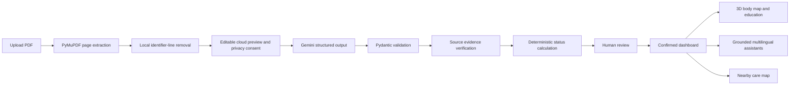
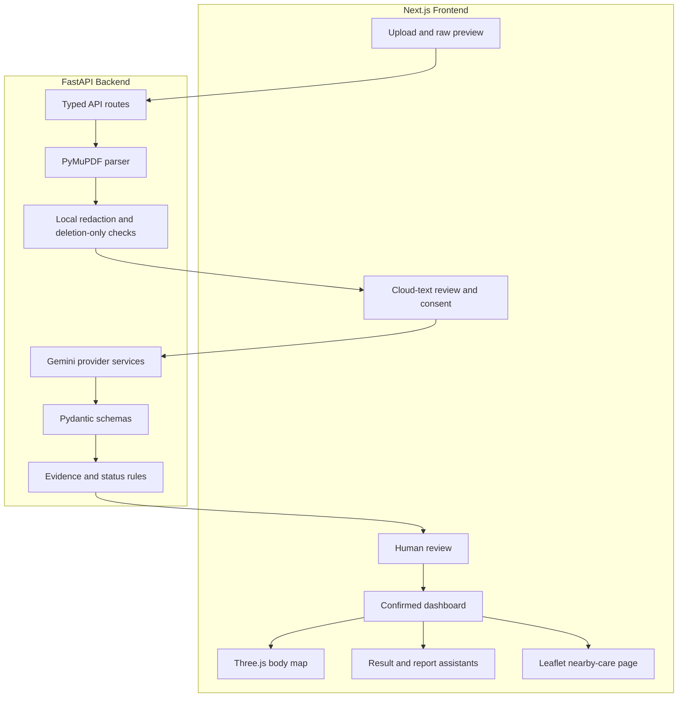

# Clarity Health AI

Clarity Health is an AI-assisted prototype that transforms text-based laboratory PDFs into reviewed, understandable health-report dashboards. It combines deterministic document processing with schema-constrained Gemini extraction, human verification, educational visualization, multilingual assistance, and nearby-care discovery.

> **Educational prototype:** Clarity Health does not diagnose conditions, prescribe treatment, determine urgency, or replace a qualified healthcare professional. Use synthetic or properly de-identified reports only.

## Highlights

- Upload and validate text-based PDF reports up to 10 MB
- Preserve page-level text for traceable source evidence
- Extract structured laboratory results with Gemini and Pydantic
- Reject fabricated source excerpts and wrong-page citations
- Calculate high, low, normal, and unknown status with deterministic code
- Require users to confirm or exclude every AI-extracted result
- Visualize confirmed values against their printed reference intervals
- Explore a synchronized, animated 3D educational body map
- Read local plain-language explanations and educational illustrations
- Ask result-specific or whole-report questions grounded in confirmed data
- Use English, Spanish, Arabic with RTL layout, or Telugu
- Open deterministic PubMed and MedlinePlus reference links
- Discover nearby clinics and hospitals with OpenStreetMap

## How It Works



The LLM is used only where language understanding is useful. File validation, reference-range comparisons, health-rating calculations, user confirmation, citation checks, research URLs, and map queries remain deterministic application logic.

## Architecture



## Technology Stack

| Layer | Technology | Responsibility |
|---|---|---|
| Frontend | Next.js, React, TypeScript | Application routes, workflow state, responsive UI |
| Styling | Tailwind CSS | Layout, visual system, responsive behavior |
| API | FastAPI, Uvicorn | Typed HTTP endpoints and server runtime |
| Validation | Pydantic | Runtime contracts and Gemini response schemas |
| PDF processing | PyMuPDF | Native page-level text extraction |
| AI | Google Gemini via `google-genai` | Structured extraction, questions, translation |
| 3D | Three.js, React Three Fiber, Drei | Interactive body map and highlights |
| Mapping | Leaflet, React Leaflet, OpenStreetMap | Nearby-care map and facility markers |
| References | PubMed, MedlinePlus | Deterministic research and patient-information links |
| Testing | Pytest, Node test runner, ESLint, Next.js build | Backend behavior and frontend quality gates |

## Safety and Grounding

Clarity Health treats AI output as untrusted until it passes multiple controls:

1. Gemini must return data matching a strict schema.
2. Missing report fields remain `null`; they are never inferred.
3. Every result includes a source page and exact source excerpt.
4. The backend verifies that the excerpt exists on the claimed page.
5. Python, not the LLM, compares numeric values with reference boundaries.
6. Every result must be confirmed or excluded by the user.
7. Assistants accept confirmed results only.
8. Whole-report citations must match test names in the submitted dataset.
9. PubMed and MedlinePlus URLs are generated by application code, not Gemini.

When a model reformats an excerpt, evidence recovery searches a bounded local block,
ignoring adjacent duplicate PDF lines for matching only. It compares complete numeric
tokens, stops at another extracted test label, and retains a contiguous excerpt from
the original reviewed page. Missing or ambiguous evidence still fails validation.

The displayed **range alignment** is a reference-range summary, not a health assessment or clinically validated score. It uses only confirmed numeric results with usable ranges and shows no score when none are available.

## Project Structure

```text
Clarity-Health-AI/
├── backend/
│   ├── app/                    # FastAPI routes, schemas, PDF and AI services
│   ├── tests/                  # Backend behavior and safety tests
│   ├── .env.example            # Safe environment template
│   └── requirements.txt
├── frontend/
│   ├── public/medical/         # Generated educational illustrations
│   └── src/
│       ├── app/                # Main and nearby-care routes
│       ├── components/         # Upload, review, dashboard, chat, map, 3D UI
│       ├── lib/                # API client, education, anatomy, language logic
│       └── types/              # Frontend data contracts
├── docs/                       # Interview guide and cheat sheet
├── samples/                    # Synthetic demonstration report
├── scripts/                    # Reproducible sample/image generators
└── README.md
```

### Gemini extraction errors

If extraction reports that Gemini is temporarily unavailable, the provider returned a
server error (for example, HTTP 503). Try again later or use the synthetic demo.
Quota/rate-limit errors require checking the Google project's quota and billing;
authentication, permission, and model errors require checking backend configuration.
The backend logs only the provider HTTP error code, not report text or credentials.

## Prerequisites

- Node.js 20 or newer
- npm 10 or newer
- Python 3.10 or newer
- A Gemini API key from [Google AI Studio](https://aistudio.google.com/apikey)

## Local Setup

### 1. Clone the repository

```powershell
git clone https://github.com/Abdul-Zahid01/Clarity-Health-AI.git
Set-Location Clarity-Health-AI
```

### 2. Configure the backend

```powershell
Set-Location backend
python -m venv .venv
.\.venv\Scripts\Activate.ps1
python -m pip install -r requirements.txt
Copy-Item .env.example .env
```

Edit `backend/.env` locally:

```text
GEMINI_API_KEY=your-api-key-here
GEMINI_MODEL=gemini-3.1-flash-lite
```

Never commit or share `backend/.env`.

Start FastAPI:

```powershell
uvicorn app.main:app --reload --port 8000
```

### 3. Configure the frontend

Open a second terminal from the repository root:

```powershell
Set-Location frontend
npm install
npm run dev
```

Open:

- Application: <http://localhost:3000>
- FastAPI documentation: <http://localhost:8000/docs>

The frontend defaults to `http://localhost:8000`. Override it by copying `frontend/.env.example` to `frontend/.env.local` and changing `NEXT_PUBLIC_API_URL`.

### macOS and Linux backend activation

```bash
cd backend
python3 -m venv .venv
source .venv/bin/activate
python -m pip install -r requirements.txt
cp .env.example .env
uvicorn app.main:app --reload --port 8000
```

## Demo Workflow

For an API-free tour, click **Explore a synthetic demo** on the home page. Four pre-authored rows mirror the synthetic sample generator; they are not AI output and still require review. Local demo mode disables AI chat and cloud translation, including inside the result detail panel. Educational text remains available in English.

1. Upload [`samples/synthetic-blood-report.pdf`](samples/synthetic-blood-report.pdf).
2. Inspect the raw page-level extraction.
3. Review the editable cloud-text preview, delete remaining identifiers, and separately confirm privacy review and cloud-processing consent.
4. Create the AI-assisted review table.
5. Correct, confirm, or exclude extracted results.
6. Finalize review to open the confirmed dashboard.
7. Select result cards to update the 3D body map.
8. Open **Learn & ask** for education and result-specific chat.
9. Open **Ask report** for cross-result questions.
10. Switch languages or open **Nearby care**.

Returning to review preserves excluded rows so they can be restored. Empty values, non-finite numbers, and reversed reference intervals must be corrected or excluded before finalizing. Numeric and text result types can be selected explicitly.

### What is sent to Gemini?

The original implementation sent extracted page text, including any printed name it contained, to Gemini after cloud consent. The upload filename was not included in the extraction prompt. A missing `display_name` in the output was **not** evidence that the name had never been transmitted.

Uploads now return a separate local cloud-text preview. Deterministic rules remove common labeled names, IDs, contacts, and referrer lines before this preview is shown. The user must review every page, delete remaining identifiers, and check a separate privacy confirmation. Editing clears that confirmation. The structure endpoint requires `privacy_review_confirmed=true` and JSON `reviewed_pages` alongside `cloud_processing_allowed=true`; it rejects missing review, invented text, changed page numbers, and empty previews. Edits are deletion-only. Gemini sees the reviewed text with page markers, not the filename or original PDF. Source evidence is checked against that reviewed text.

**This is not certified de-identification.** Label rules can miss unlabeled names, multilingual/OCR variations, embedded identifiers, and addresses, and can remove useful header text. Raw extraction and the filename remain visible in the local UI and are transmitted to the local backend. Do not upload identifiable records. Existing review sessions do not retroactively lose identifiers: re-upload and review the cloud preview. Report/result/RAG assistants send confirmed result fields and source excerpts, questions, and recent history; do not reintroduce identifiers there. For a future real-data service, evaluate a local tool such as [Presidio](https://github.com/data-privacy-stack/presidio) plus human review rather than treating regex as complete anonymization.

### Public educational-demo deployment

The recommended first release is **frontend only**, with no publicly exposed backend:

1. Deploy `frontend` on a Next.js-compatible host; use `npm ci`, `npm run build`, and `npm start` (or the host's Next.js integration).
2. Set `NEXT_PUBLIC_DEMO_ONLY=true` **before building**. This removes uploads from the UI; the local fixture review, dashboard, atlas, and education remain available. Do not configure or deploy Gemini credentials for this release.
3. Use HTTPS, review the disclaimer and model attribution, and test the deployed page on desktop/mobile and with reduced motion. Nearby care is optional and sends browser coordinates to OpenStreetMap/Overpass only after the user opens that feature and grants location permission.
4. Verify the deployed build shows no upload control and makes no backend/AI calls during the local demo. Changing a `NEXT_PUBLIC_*` setting requires a rebuild.

This frontend flag is **not an API access-control mechanism**. Do not expose the current backend as part of this public demo. The full upload/AI workflow remains available for local development when the flag is false.

### Body atlas rendering

The body atlas loads its Three.js scene and local model only after the dashboard is opened and the atlas enters the viewport. It uses local lights instead of a remotely fetched HDR environment, a single-sided translucent shell, standard organ materials, instanced flow markers, and demand rendering with animation requests capped at 30 per second. It does not preserve the drawing buffer. Rendering idles while paused, offscreen, or in a hidden tab; reduced-motion users get a static interactive view. Rotation/reset buttons work without dragging.

Loading, WebGL failure, model errors, and context loss have explicit fallback copy; the system legend and explanation stay usable without 3D. Internal organ shapes are schematic educational illustrations, not clinical anatomy. The BodyParts3D skin attribution and license are available in the atlas.

Organs retain natural tissue-inspired colors when selected; related structures brighten while context is muted. Ivory skeletal paths and golden nerves provide orientation. Hemoglobin selects circulation and marrow, not nerves; explicit cardiac markers select the heart with a subtle illustrative pulse, never a measured heartbeat. TSH selects the thyroid and a separate pituitary marker, with visible callouts and selection rings. Marker names normalize punctuation and support common count, thyroid, lipid, and chemistry aliases. Lipids show cardiovascular context rather than locating disease. Unknown tests do not invent organ associations.

**Learn & ask** opens a focused, authored SVG process scene rather than repeating the full-body image: red-cell transport, immune cells, platelets, kidney filtration, glucose uptake, pituitary/thyroid signaling, liver processing, cardiac markers, lipid transport, mineral balance, or nerve support. HbA1c has red-cell rather than instantaneous-glucose context. Three selectable stages explain the process. Playback is opt-in and pauses offscreen or in hidden tabs; reduced-motion users use manual steps. These are schematic teaching scenes, not patient-specific simulations. The full-body location diagram and original laboratory illustration remain available in collapsed sections. New lesson copy is currently English.

### Anatomy tools researched

| Resource | Useful pattern or role | Integration decision |
|---|---|---|
| [BioDigital Human](https://www.biodigital.com/) | Focused, embeddable anatomy/physiology scenes and authored teaching content | Product reference, not a free/open-source asset pool. Confirm commercial terms before embedding; do not copy its models. |
| [ZygoteBody](https://www.zygotebody.com/) | Layer opacity, isolation, labels, and zoom-to selection | UX reference. Some features are premium and 3D data is copyrighted; do not assume redistribution rights. |
| [Open Anatomy](https://www.openanatomy.org/) and [technical details](https://www.openanatomy.org/technology.html) | Open atlas work and labeled, linked anatomical structures | Evaluate atlas data/license individually. Its documented prototype uses Angular 1/Three.js and is desktop-oriented, not a drop-in mobile React library. |
| [Drei](https://github.com/pmndrs/drei) | Existing React Three Fiber helpers for labels, camera controls, and model loading | Already installed; reuse it for callouts instead of adding another renderer. It does not supply anatomical models. |
| [glTF Transform](https://gltf-transform.dev/) | MIT-licensed tools to split, optimize, and compress glTF assets | Candidate for a later licensed multi-organ asset pipeline; it is not an anatomy content library and is not installed by this change. |

Recommendation: keep the current renderer, pair an overview atlas with focused process lessons, and introduce separately named, licensed organ meshes only after asset-rights and mobile-budget checks. No external model library or remote anatomy embed was added in this pass.

The report chat uses a bounded dynamic-viewport layout, a separately scrolling conversation, collapsible follow-up questions and safety details, and a compact pinned composer. Long answers, source excerpts, and questions wrap inside the panel.

### RAG voice support (opt-in)

Open **Ask report → Research / RAG → Voice options**, read the disclosure, and enable voice for that chat session. **Dictate question** starts single-utterance browser recognition; **Finish dictation** ends capture, and **Cancel** aborts. The transcript is inserted into the editable draft, never automatically submitted. Verify it and remove identifiers before **Send**. Sending is disabled while listening. The selected UI language selects the speech locale.

- [Browser SpeechRecognition](https://developer.mozilla.org/en-US/docs/Web/API/SpeechRecognition) has varying browser/language support and may send audio to the browser provider. It is not promised to be offline. HTTPS (or localhost), explicit consent, and microphone permission are required. Denied permissions, missing microphones, network errors, unsupported languages, and unavailable APIs have text fallbacks.
- **Read latest answer** is explicit and includes the safety note. It uses only a matching [localService voice](https://developer.mozilla.org/en-US/docs/Web/API/SpeechSynthesisVoice/localService), with long text queued in small chunks. Without a local voice for the selected language it stays disabled rather than sending text to a remote synthesizer. Nothing is read automatically.
- Closing chat, changing assistant/language, hiding the tab, or withdrawing voice consent cancels owned audio work. This app does not record or persist audio. Session consent is not persisted.
- **Future local-first dictation:** an on-device Whisper-compatible model avoids a browser-provider dependency, but needs model downloads, CPU/memory, mobile benchmarking, and license review.
- Voice does not make Gemini free: existing answer-generation quota and costs still apply. Use synthetic/de-identified inputs only for this prototype.

### RAG development setup

The report panel offers separate **My report assistant** and **RAG assistant** modes. RAG combines confirmed report evidence with page-traceable PDF chunks from `docs/`, then verifies returned source IDs and evidence quotes. Quote checks and token overlap are not proof that every medical claim is semantically entailed.

- `RAG_RETRIEVAL_MODE=keyword`: cached local BM25 retrieval; no database required.
- `RAG_RETRIEVAL_MODE=vector`: PostgreSQL/pgvector retrieval; requires `DATABASE_URL` and an indexed corpus.
- `RAG_RETRIEVAL_MODE=hybrid` (default): combines keyword and configured vector retrieval. Without a database it uses keyword retrieval.

To index the curated corpus locally:

```powershell
docker compose up -d postgres
Set-Location backend
.\.venv\Scripts\python.exe -m app.rag_index --docs-dir ..\docs
```

Configure database/embedding settings from the safe backend environment template locally. The indexer sends curated document chunks to the configured Gemini embedding service. Confirm redistribution, indexing, and provider-processing rights for the corpus first; do not replace it with identifiable reports.

## API Endpoints

| Method | Route | Purpose |
|---|---|---|
| `GET` | `/health` | Backend health check |
| `POST` | `/api/reports/extract` | Extract raw text and locally redacted cloud-preview pages |
| `POST` | `/api/reports/structure` | Produce schema-constrained results from explicitly reviewed cloud text |
| `POST` | `/api/results/ask` | Ask about one confirmed result |
| `POST` | `/api/reports/ask` | Ask across the confirmed report |
| `POST` | `/api/rag/ask` | Ask with verified report and retrieved knowledge-base citations |
| `POST` | `/api/translate` | Translate educational content |

## Tests and Quality Checks

Run backend tests from the repository root:

```powershell
backend\.venv\Scripts\python.exe -m pytest backend -q
```

Run frontend checks:

```powershell
Set-Location frontend
npm test
npm run lint
npm run build
```

Current verified baseline:

- 80 backend tests passing (one existing Starlette/AnyIO deprecation warning)
- 21 deterministic frontend tests with TypeScript and Node's built-in test runner; no additional test dependencies
- Frontend lint passing without warnings
- Next.js production build passing
- Live Gemini and PostgreSQL integration are not exercised by these local regression checks

## Multilingual Support

Core UI labels are local dictionaries for instant switching. Long educational paragraphs are translated on demand through Gemini. Supported languages:

- English, default
- Spanish
- Arabic, including right-to-left layout
- Telugu

Medical translations in a production system would require professional review.

## Nearby Care

The nearby-care page requests browser location permission and queries OpenStreetMap/Overpass for healthcare facilities within 10 km. It displays available names, addresses, phone numbers, specialties, websites, and distances.

OpenStreetMap does not provide dependable doctor ratings or review text. The UI therefore links to an external map search for reviews instead of displaying fabricated scores. Report-derived specialty labels are discussion aids, not referrals.

## Known Limitations

- Native text extraction is preferred; image-only pages use the CPU Tesseract fallback and are marked for review.
- AI extraction has not yet been benchmarked against a large golden dataset.
- The application has no authentication or persistent report history.
- Educational translations have not received professional medical review.
- The body atlas uses schematic organ shapes and is not anatomically diagnostic.
- Range alignment is not a clinically validated health score.
- Public OpenStreetMap/Overpass data may be incomplete or temporarily unavailable.
- This prototype does not claim HIPAA, GDPR, or other regulatory compliance.

## Release gaps and next priorities

The frontend-only synthetic demo is the release scope of this pass, **not approval to launch a medical-data service**. Source review and local checks do not replace a dedicated security, clinical, accessibility, or legal review.

| Priority / release gate | Gap | Required follow-up |
|---|---|---|
| Before publishing the demo | Hosting and third-party rights are unverified | Deploy the demo-only build over HTTPS; review notices, asset/corpus redistribution rights, privacy copy, and actual deployed network behavior. Do not expose the backend or bundle keys. |
| Before exposing any AI endpoint | No identity/access controls, request quotas, cost ceilings, or abuse controls | Add server-side authentication or a gated pilot, per-user/IP limits, request/token budgets, provider deadlines, and spend alerts. CORS is not authentication. |
| Before trusting uploaded reports | Evidence heuristics verify excerpts/tokens but do not fully establish every extracted field; client confirmation/status is request data | Benchmark field-level and page/quote accuracy against versioned golden fixtures. Strengthen local evidence-span matching and server-side validation/recalculation; design verifiable review state before persisting or sharing reports. |
| Before enabling broad RAG access | Quote presence and lexical overlap do not prove claim entailment; vector tests do not cover a live database | Evaluate unsupported-claim/refusal rates, multilingual grounding, and document coverage. Add deterministic retrieval cases and real pgvector integration tests; version and audit the licensed knowledge corpus. |
| Before accepting larger traffic | PDF/OCR work is synchronous in the upload flow; the 10 MB limit is not a page/CPU/token budget | Set page, pixel, processing-time and context limits; isolate CPU work from the API event loop, bound concurrency, and make timeout/retry behavior explicit. Measure extraction and response p95 latency. |
| Before real medical data | No report lifecycle, de-identification pipeline, or reviewed privacy/compliance design | Establish consent, identifier handling, data minimization, encryption, access/audit policy, retention/deletion, vendor agreements, and jurisdiction-specific legal review before adding storage. |
| Before claiming reliable accessibility/localization | Labels and educational content are only partly localized; dialogs and review-table usability need a full audit | Complete dictionaries, error/loading translations, focus management, screen-reader/keyboard tests, RTL/mobile flows, and professional medical-language review. Atlas-specific copy is currently English. |
| Before a full workflow release | Frontend helper tests and backend mocks do not cover end-to-end integrations or deployment operations | Add CI gates, replayable synthetic upload/review/chat/OCR flows, provider contract tests, database readiness checks, redacted structured logs, error monitoring, cost/latency dashboards, backups and rollback drills where storage is deployed. |
| Later visual refinement | Internal organs are schematic; the local skin model is still about 4.9 MB | Validate low-end mobile GPU behavior and asset budgets. Optimize or decimate a properly attributed derived model, and commission licensed organ meshes if user research justifies the download/rendering cost. Avoid heavier effects until measured. |

## Roadmap

- Build a versioned synthetic evaluation dataset and accuracy metrics
- Improve Tesseract OCR evaluation and add a GPU-backed OCR service only if CPU quality is insufficient
- Detect and redact identifiers before cloud processing
- Generate frontend types from FastAPI's OpenAPI schema
- Add authentication, encrypted storage, and deletion controls
- Add rate limiting, observability, provider retries, and cost tracking
- Professionally review medical content and translations
- Replace public map infrastructure for production reliability

## Interview Resources

- [Comprehensive architecture and interview guide](docs/INTERVIEW_GUIDE.md)
- [Word-for-word meeting and demo script](docs/INTERVIEW_MEETING_SCRIPT.md)
- [Last-minute interview cheat sheet](docs/INTERVIEW_CHEAT_SHEET.md)

## Responsible Use

This repository is intended for prototyping, education, and portfolio demonstration. Do not upload identifiable medical records without appropriate permission, de-identification, security controls, and legal review.

## Tesseract OCR Setup

Tesseract is a separate system executable. The Python packages are installed from `backend/requirements.txt`, but the executable must also be installed on the machine.

Windows with WinGet:

```powershell
winget install --id tesseract-ocr.tesseract --exact
tesseract --version
```

On macOS or Linux, install the `tesseract-ocr` package through the operating system package manager. Native PyMuPDF extraction remains the default; Tesseract runs only for pages where no readable native text is found. OCR pages are marked `needs_review` because a single digit or flag can be misread.